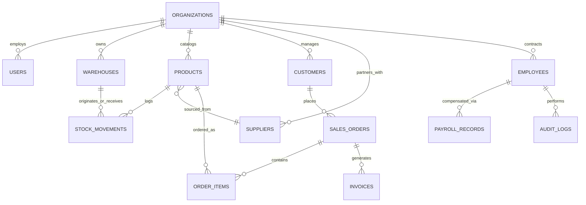

# 🗄️ IT-HUB ERP — Enterprise Data Model Specification

## 1. Entity Relationship Overview

---

## 2. Core Tables & Schemas

### `products`
* `id` (UUID / TEXT, Primary Key)
* `sku` (TEXT, Unique, Indexed)
* `barcode` (TEXT, Optional, Indexed)
* `name` (TEXT, Not Null)
* `category_id` (TEXT, Foreign Key)
* `warehouse_id` (TEXT, Foreign Key)
* `bin_location` (TEXT)
* `cost_price` (DECIMAL(12, 2), Not Null)
* `selling_price` (DECIMAL(12, 2), Not Null)
* `current_stock` (INTEGER, Default 0)
* `min_threshold` (INTEGER, Default 10)
* `max_capacity` (INTEGER, Default 100)
* `unit` (TEXT, Default 'Units')
* `supplier_id` (TEXT, Foreign Key)
* `status` (ENUM: `'In Stock'`, `'Low Stock'`, `'Critical Low'`, `'Out of Stock'`)
* `created_at` (TIMESTAMPTZ, Default NOW())
* `updated_at` (TIMESTAMPTZ, Default NOW())

### `stock_movements`
* `id` (TEXT, Primary Key, e.g. `MOV-2026-9041`)
* `product_id` (TEXT, Foreign Key -> `products.id`)
* `warehouse_id` (TEXT, Foreign Key -> `warehouses.id`)
* `type` (ENUM: `'Stock In'`, `'Stock Out'`, `'Audit Adjustment'`)
* `quantity` (INTEGER, Signed delta)
* `reference` (TEXT, e.g. `PO-88410`, `SO-10928`)
* `operator` (TEXT, User Name or ID)
* `notes` (TEXT)
* `created_at` (TIMESTAMPTZ, Default NOW())

### `warehouses`
* `id` (TEXT, Primary Key)
* `code` (TEXT, Unique)
* `name` (TEXT, Not Null)
* `city` (TEXT)
* `capacity` (INTEGER)
* `current_usage` (INTEGER)
* `manager` (TEXT)
* `email` (TEXT)
* `phone` (TEXT)
* `status` (TEXT, Default 'Operational')

### `suppliers`
* `id` (TEXT, Primary Key)
* `code` (TEXT, Unique)
* `name` (TEXT, Not Null)
* `category` (TEXT)
* `contact_person` (TEXT)
* `email` (TEXT)
* `phone` (TEXT)
* `lead_time_days` (INTEGER)
* `rating` (DECIMAL(3, 2))
* `status` (TEXT, Default 'Active')

### `customers` (CRM)
* `id` (TEXT, Primary Key)
* `name` (TEXT, Not Null)
* `company` (TEXT)
* `email` (TEXT)
* `phone` (TEXT)
* `status` (ENUM: `'Lead'`, `'Prospect'`, `'Active Customer'`, `'Inactive'`)
* `total_spend` (DECIMAL(12, 2), Default 0)

### `sales_orders`
* `id` (TEXT, Primary Key, e.g. `SO-2026-1049`)
* `customer_id` (TEXT, Foreign Key)
* `order_date` (TIMESTAMPTZ)
* `status` (ENUM: `'Draft'`, `'Confirmed'`, `'Dispatched'`, `'Fulfilled'`, `'Cancelled'`)
* `total_amount` (DECIMAL(12, 2))
* `tax_amount` (DECIMAL(12, 2))
* `payment_status` (ENUM: `'Pending'`, `'Paid'`, `'Overdue'`)

### `employees` (HR)
* `id` (TEXT, Primary Key)
* `employee_code` (TEXT, Unique)
* `full_name` (TEXT, Not Null)
* `department` (TEXT)
* `designation` (TEXT)
* `email` (TEXT)
* `phone` (TEXT)
* `base_salary` (DECIMAL(12, 2))
* `join_date` (DATE)
* `status` (ENUM: `'Active'`, `'On Leave'`, `'Terminated'`)

### `audit_logs`
* `id` (UUID, Primary Key)
* `user_id` (TEXT)
* `action` (TEXT)
* `entity_type` (TEXT)
* `entity_id` (TEXT)
* `payload` (JSONB)
* `created_at` (TIMESTAMPTZ, Default NOW())
