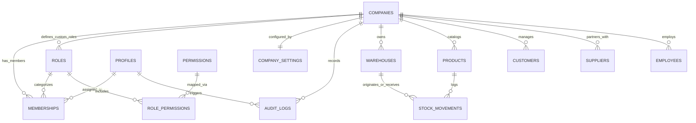

# 🗄️ IT-HUB ERP — Enterprise Data Model Specification

## 1. Multi-Tenant Entity Relationship Diagram



---

## 2. Authentication, Tenancy & RBAC Tables

### `companies`
Tenant organization root entity. All domain resources are partitioned by `company_id`.
* `id` (`UUID`, Primary Key, `gen_random_uuid()`)
* `name` (`TEXT`, Not Null)
* `slug` (`TEXT`, Unique, Not Null)
* `domain` (`TEXT`, Optional custom domain)
* `plan` (`TEXT`, Default `'ENTERPRISE'`)
* `status` (`TEXT`, Check: `'ACTIVE'`, `'SUSPENDED'`, `'PENDING'`)
* `created_at` (`TIMESTAMPTZ`, Default `NOW()`)
* `updated_at` (`TIMESTAMPTZ`, Default `NOW()`)
* `created_by` (`UUID`)

### `profiles`
User profile extension synchronized with Supabase `auth.users(id)` via automated trigger.
* `id` (`UUID`, Primary Key, References `auth.users(id)` ON DELETE CASCADE)
* `email` (`TEXT`, Unique, Not Null)
* `full_name` (`TEXT`, Not Null)
* `avatar_url` (`TEXT`)
* `is_super_admin` (`BOOLEAN`, Default `FALSE`)
* `created_at` (`TIMESTAMPTZ`, Default `NOW()`)
* `updated_at` (`TIMESTAMPTZ`, Default `NOW()`)

### `roles`
PRD system roles (shared, `company_id IS NULL`) and tenant-specific custom roles.
* `id` (`UUID`, Primary Key, `gen_random_uuid()`)
* `company_id` (`UUID`, References `companies(id)` ON DELETE CASCADE, Nullable for system roles)
* `name` (`TEXT`, Not Null)
* `code` (`TEXT`, Not Null, Unique per company)
* `description` (`TEXT`)
* `is_system` (`BOOLEAN`, Default `FALSE`)
* `created_at` (`TIMESTAMPTZ`, Default `NOW()`)
* `updated_at` (`TIMESTAMPTZ`, Default `NOW()`)
* `created_by` (`UUID`)

### `permissions`
Granular privilege catalog across resources and operations.
* `id` (`UUID`, Primary Key, `gen_random_uuid()`)
* `code` (`TEXT`, Unique, Not Null, e.g. `'inventory:view'`, `'finance:approve'`)
* `resource` (`TEXT`, Not Null, e.g. `'inventory'`, `'crm'`, `'finance'`)
* `action` (`TEXT`, Not Null, e.g. `'view'`, `'create'`, `'edit'`, `'delete'`, `'export'`, `'approve'`)
* `description` (`TEXT`)
* `created_at` (`TIMESTAMPTZ`, Default `NOW()`)

### `role_permissions`
Many-to-many junction mapping roles to assigned granular permissions.
* `role_id` (`UUID`, References `roles(id)` ON DELETE CASCADE)
* `permission_id` (`UUID`, References `permissions(id)` ON DELETE CASCADE)
* `created_at` (`TIMESTAMPTZ`, Default `NOW()`)
* Primary Key: `(role_id, permission_id)`

### `memberships`
Server-verified association between a user, tenant company, and role.
* `id` (`UUID`, Primary Key, `gen_random_uuid()`)
* `company_id` (`UUID`, References `companies(id)` ON DELETE CASCADE)
* `user_id` (`UUID`, References `profiles(id)` ON DELETE CASCADE)
* `role_id` (`UUID`, References `roles(id)` ON DELETE RESTRICT)
* `status` (`TEXT`, Check: `'ACTIVE'`, `'INVITED'`, `'SUSPENDED'`, Default `'ACTIVE'`)
* `created_at` (`TIMESTAMPTZ`, Default `NOW()`)
* `updated_at` (`TIMESTAMPTZ`, Default `NOW()`)
* `created_by` (`UUID`)
* Unique: `(company_id, user_id)`

### `company_settings`
Tenant-specific configuration and localization preferences.
* `company_id` (`UUID`, Primary Key, References `companies(id)` ON DELETE CASCADE)
* `currency` (`TEXT`, Default `'USD'`)
* `timezone` (`TEXT`, Default `'UTC'`)
* `fiscal_year_start` (`TEXT`, Default `'01-01'`)
* `theme` (`TEXT`, Default `'obsidian'`)
* `features` (`JSONB`, Default `'{}'::jsonb`)
* `updated_at` (`TIMESTAMPTZ`, Default `NOW()`)
* `updated_by` (`UUID`)

### `audit_logs`
Immutable enterprise change and security event trail.
* `id` (`UUID`, Primary Key, `gen_random_uuid()`)
* `company_id` (`UUID`, References `companies(id)` ON DELETE CASCADE)
* `user_id` (`UUID`, References `profiles(id)` ON DELETE SET NULL)
* `action` (`TEXT`, Not Null)
* `resource` (`TEXT`, Not Null)
* `resource_id` (`TEXT`)
* `details` (`JSONB`, Default `'{}'::jsonb`)
* `ip_address` (`TEXT`)
* `user_agent` (`TEXT`)
* `created_at` (`TIMESTAMPTZ`, Default `NOW()`)

---

## 3. PostgreSQL Row-Level Security (RLS) Model

1. **Security Definer Helper Functions**:
   * `public.is_super_admin()`: Returns `TRUE` if `profiles.is_super_admin = TRUE` for `auth.uid()`.
   * `public.user_company_ids()`: Returns all `company_id`s where caller has `status = 'ACTIVE'` membership.
   * `public.has_company_permission(comp_id, perm_code)`: Evaluates if caller is Super Admin or has role granting `perm_code`.
2. **Multi-Tenant Policy Rule**: Every query on tenant-owned tables is bounded by:
   ```sql
   USING (company_id IN (SELECT user_company_ids()) OR public.is_super_admin())
   ```
   Ensuring Company A users can never read or mutate Company B data under any circumstances.
