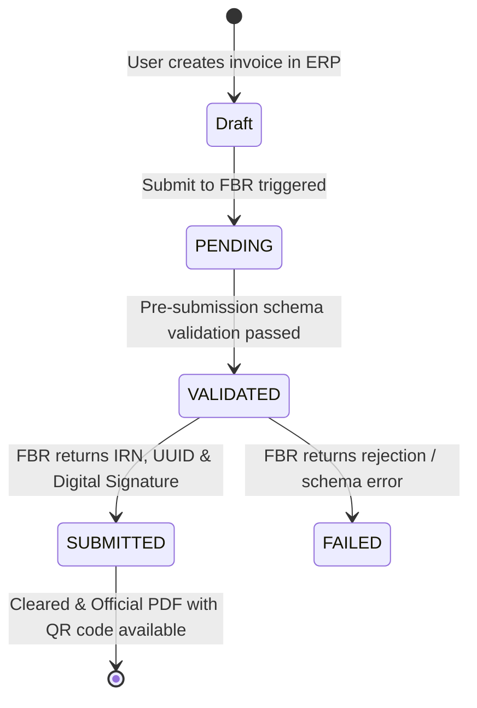

# FBR Digital Invoicing System Specification

This document details the **FBR Digital Invoicing (DI) API v1.12** implementation within IT-HUB ERP, including schema specifications, payload construction, cryptographic signatures, QR code formatting, and PDF rendering.

---

## 1. FBR Digital Invoicing API Specification (v1.12)

The system adheres to the PRAL/FBR Electronic Invoicing specification for commercial B2B, B2C, and Retail transactions in Pakistan.

### Authentication Flow
- **Protocol**: OAuth 2.0 Client Credentials Grant.
- **Header**: `Authorization: Bearer <access_token>`.
- **Token Cache**: In-memory token management with automated 60-second early expiration protection ([`src/lib/fbr-api.ts`](file:///e:/new%20data/erp%20software/src/lib/fbr-api.ts)).

---

## 2. Payload Structure

The invoice payload is constructed server-side in [`src/lib/fbr-service.ts`](file:///e:/new%20data/erp%20software/src/lib/fbr-service.ts#L60-L120):

```json
{
  "seller_ntn": "1234567-8",
  "buyer_ntn": "7654321-0",
  "buyer_cnic": "16101-5419566-3",
  "buyer_name": "Valued Enterprise Client",
  "invoice_number": "INV-2026-0001",
  "invoice_date": "2026-10-21",
  "invoice_type": "Standard",
  "total_bill_amount": 11800.00,
  "total_sales_tax": 1800.00,
  "total_net_amount": 10000.00,
  "items": [
    {
      "item_code": "PROD-001",
      "description": "Enterprise Cloud Server License",
      "hs_code": "8523.49.00",
      "quantity": 2.0,
      "unit_price": 5000.00,
      "tax_rate": 18.0,
      "tax_amount": 1800.00,
      "total_amount": 11800.00,
      "discount": 0.00
    }
  ]
}
```

### Key Mandatory Fields:
- **`hs_code`**: Harmonized System (HS) Tariff Code required by Pakistan Customs and FBR for all taxable goods.
- **`seller_ntn`**: The registered tax number of the issuing company.
- **`buyer_ntn` / `buyer_cnic`**: Required for commercial tax compliance and claiming input tax credit.

---

## 3. Invoice Clearance Lifecycle & Statuses



### Database Columns ([`supabase/migrations/20261020000000_fbr_digital_invoicing.sql`](file:///e:/new%20data/erp%20software/supabase/migrations/20261020000000_fbr_digital_invoicing.sql)):
- `fbr_irn`: Official Invoice Reference Number returned by FBR.
- `fbr_uuid`: Unique document tracking UUID.
- `fbr_qr_code_data`: Formatted QR code payload string.
- `fbr_digital_signature`: Digital cryptographic authentication signature.
- `fbr_status`: Verification state (`PENDING`, `VALIDATED`, `SUBMITTED`, `FAILED`).

---

## 4. FBR QR Code Specification

The QR code is generated server-side using the `qrcode` library in [`src/lib/pdf/invoice-pdf-generator.ts`](file:///e:/new%20data/erp%20software/src/lib/pdf/invoice-pdf-generator.ts):

- **Standard**: QR Code Version 2.0 (25×25 matrix).
- **Physical Dimensions**: Exactly **1.0 inch × 1.0 inch (72 pt × 72 pt)** as mandated by FBR regulations.
- **Error Correction**: Level M (Medium).
- **Standard Payload Syntax**:
  ```text
  <FBR_IRN>||<SELLER_NTN>||<INVOICE_DATE>||<GRAND_TOTAL>||<TAX_TOTAL>
  ```
  Example:
  ```text
  FBR-IRN-2026-987654||1234567-8||2026-10-21||11800.00||1800.00
  ```

---

## 5. Official PDF Layout & Branding

The invoice PDF generator renders an authentic, print-ready fiscal document:
- **FBR National Emblem Banner**: Rendered in official Pakistan National Emerald Green (`#006633`).
- **IRN & Clearance Display**: Prominently highlights the FBR IRN and Fiscal UUID.
- **Status Badge**: Distinguishes between `SUBMITTED (Authenticated Online)` and `PENDING (Not Yet Cleared)`.
- **Digital Signature**: Prints the first 48 characters of the SHA-256 digital signature.
- **Compliance Watermark**: Includes the legal notice confirming electronic fiscal generation under Sales Tax Rules 2006.
