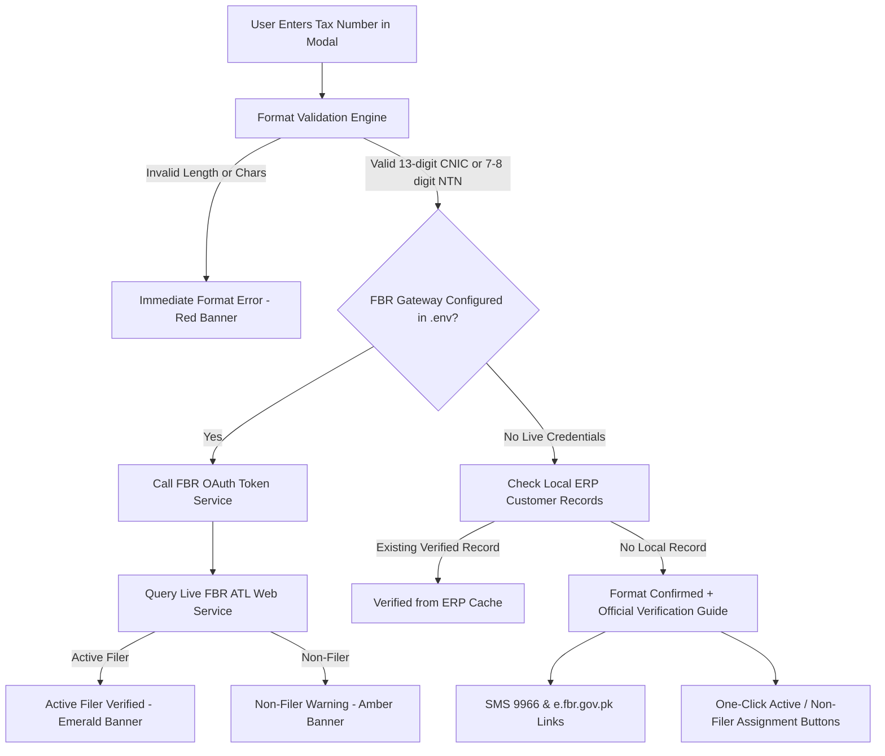

# FBR Taxpayer & Active Taxpayer List (ATL) Verification

This document specifies the verification architecture for Pakistani tax identifiers (CNIC and NTN) and the **Active Taxpayer List (ATL)** compliance rules implemented in IT-HUB ERP.

---

## 1. Statutory Background: Filer vs Non-Filer Rates

Under the Income Tax Ordinance 2001 (as amended by Finance Acts):
- **Active Filer**: Registered on the FBR Active Taxpayers List (ATL) with up-to-date income tax returns.
- **Non-Filer**: Not found on ATL or delinquent in return submissions. Non-filers are subject to **100% higher withholding tax penalties (2× rates)**.

### Statutory Rates Applicable in ERP:
| Customer Category | Governing Section | Active Filer Rate | Non-Filer Rate |
| :--- | :---: | :---: | :---: |
| **Retailer** | Section 236H | **0.5%** | **1.0%** |
| **Wholesaler / Distributor** | Section 236G | **0.1%** | **0.2%** |

---

## 2. Tax Identifier Format Specifications

The ERP strictly enforces NADRA and FBR syntax standards in [`src/lib/fbr-validation.ts`](file:///e:/new%20data/erp%20software/src/lib/fbr-validation.ts):

### A. Pakistani CNIC (Individuals & Sole Proprietors)
- **Length**: Exactly **13 numeric digits**.
- **Format**: `XXXXX-XXXXXXX-X` or `XXXXXXXXXXXXX`.
- **Structural Analysis**:
  - **Digit 1 (Province Code)**:
    - `1` = Khyber Pakhtunkhwa
    - `2` = FATA / Merged Districts
    - `3` = Punjab
    - `4` = Sindh
    - `5` = Balochistan
    - `6` = Islamabad Capital Territory
    - `7` = Gilgit-Baltistan / AJK
  - **Digits 1–5**: Administrative division and district code.
  - **Digits 6–12**: Family tree sequence number.
  - **Digit 13 (Gender Check)**:
    - Odd (`1, 3, 5, 7, 9`) = Male
    - Even (`2, 4, 6, 8`) = Female
- **Rejection Criteria**: Any string with characters, spaces, or length $\ne 13$ (e.g. 15-digit numbers like `161015419561411`) is **immediately rejected with a red alert**.

### B. FBR NTN (Corporate & Partnership Entities)
- **Length**: **7 or 8 numeric digits**.
- **Format**: `XXXXXXX-X` or `XXXXXXX`.
- **Modulo 11 Checksum Algorithm**:
  - Base: 7 digits ($d_1 d_2 d_3 d_4 d_5 d_6 d_7$)
  - Weights: $[8, 7, 6, 5, 4, 3, 2]$
  - $\text{Sum} = \sum_{i=1}^{7} (d_i \times w_i)$
  - $\text{Remainder} = \text{Sum} \pmod{11}$
  - $\text{Check Digit} = (11 - \text{Remainder}) \pmod{11}$

---

## 3. Verification Architecture & Request Flow

Taxpayer verification is managed server-side via [`/api/fbr/verify-taxpayer`](file:///e:/new%20data/erp%20software/src/app/api/fbr/verify-taxpayer/route.ts):



---

## 4. Official Manual Verification Fallbacks

Because FBR does not offer an open, unauthenticated public REST API without licensed PRAL credentials, the ERP provides direct access to official verification methods:

### 1. Official FBR SMS Service (Instant Verification)
- **For Individuals (CNIC)**:
  ```
  Send SMS: ATL <13-digit-CNIC> to 9966
  Example: ATL 1610154195663
  ```
- **For Companies (NTN)**:
  ```
  Send SMS: ATL <7-digit-NTN> to 9966
  Example: ATL 1234567
  ```
- The FBR cellular gateway replies within 10–30 seconds with the active filer status and taxpayer name.

### 2. Official FBR Online Verification Portal
- Clickable link provided directly in the ERP modal:
  [https://e.fbr.gov.pk/](https://e.fbr.gov.pk/)
- Navigates to the public Active Taxpayer List (Income Tax) search portal.

---

## 5. UI States in Customer Registration Modal

| Scenario | UI Indicator | Action Required |
| :--- | :--- | :--- |
| **Invalid Format** (e.g. `161015419561411`) | 🔴 **Red Banner**: Error explaining 15 digits entered instead of 13 | Correct the CNIC/NTN number |
| **Live FBR Verified Active** | 🟢 **Emerald Banner**: Official FBR record confirmed | Auto-sets `salesTaxAtl: "Active"` (0.5% rate) |
| **Live FBR Non-Filer** | 🟡 **Amber Banner**: Taxpayer listed as Inactive | Auto-sets `salesTaxAtl: "In-Active"` (1.0% penalty) |
| **Valid Format (Pending Gateway)** | 🔵 **Blue Banner**: Province & gender confirmed, official SMS/Portal links shown | User clicks **"✓ Set Active"** or **"✕ Set Non-Filer"** |
