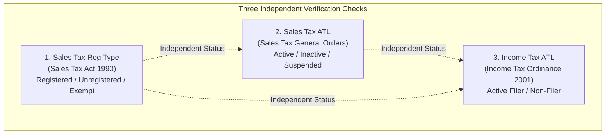
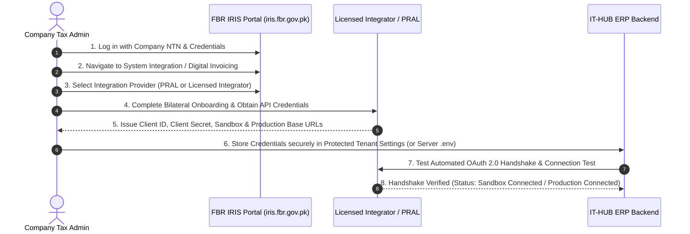

# FBR Taxpayer Verification Services: Technical Research & Integration Feasibility

**Document Reference**: `docs/FBR_VERIFICATION_RESEARCH.md`  
**Author**: IT-HUB ERP Architecture Team  
**Date**: October 2026  
**Status**: Verified Technical Research Report  
**Subject**: Statutory & API Analysis of FBR Taxpayer Verification Services (Sales Tax Reg Type, Sales Tax ATL, Income Tax ATL)

---

## 1. Executive Summary & Critical Demarcation

This research report investigates the availability, official channels, authentication mechanisms, and integration constraints for the **three taxpayer verification indicators** required under Pakistani tax regulations and matching the UNAZ interface:

1. **Sales Tax Reg Type** (Sales Tax Registration Classification)
2. **Sales Tax ATL** (Sales Tax Active Taxpayer List Status)
3. **Income Tax ATL** (Income Tax Active Taxpayer List Status)

### ⚠️ Critical Rule: Digital Invoicing API vs. Taxpayer Verification Services

A common architectural trap in Pakistani ERP development is conflating the **FBR Digital Invoicing API** (governed by SRO 1525(I)/2023 and SRO 730(I)/2024) with **Taxpayer Verification Services**:

| Feature / Dimension | FBR Digital Invoicing API (PRAL DI v1.12) | FBR Taxpayer Verification Services |
| :--- | :--- | :--- |
| **Primary Objective** | Real-time fiscal clearance of sales invoices, generation of official Invoice Reference Numbers (IRN) and QR codes. | Verification of taxpayer identity, registration categories, and Active/Inactive tax compliance status. |
| **Input Required** | Complete structured invoice JSON payload (seller NTN, buyer NTN/CNIC, line items, HS codes, unit prices, tax amounts). | Tax Identifier only (13-digit CNIC, 7/8-digit NTN, or STRN). |
| **Buyer Validation** | Validates `buyer_ntn` / `buyer_cnic` as part of invoice validation rules; rejects invoice if buyer is suspended or blacklisted. | Standalone lookup returning registration profile and compliance state. |
| **Public Lookup Feasibility** | **Cannot** be queried arbitrarily without generating a full invoice payload. | Standalone query performed during customer onboarding or master data review. |

---

## 2. Analysis of the Three Verification Checks & Official Sources

Each verification check serves a distinct statutory purpose under Pakistan Federal tax laws. **An entity's status under one check cannot be assumed or inferred from another.**



### Check 1: Sales Tax Registration Type (Sales Tax Reg Type)
* **Governing Legislation**: *Sales Tax Act, 1990* and *Sales Tax Rules, 2006*.
* **Statutory Meaning**: Classifies whether an entity or individual holds a Sales Tax Registration Number (STRN) and specifies their operating registration category (Manufacturer, Retailer, Wholesaler/Distributor, Importer, Exporter, or Commercial Service Provider).
* **Possible Statuses**:
  - `Registered` (Holds active STRN)
  - `Unregistered` (Not registered for Federal Sales Tax)
  - `Exempt` (Operations exclusively covered under Sixth Schedule exemptions)
  - `Zero Rated` (Covered under Fifth Schedule export/zero-rating)
  - `Wholesaler / Retailer` (Specific tier-1 or registered distributor status)
  - `Pending` (Format validated, awaiting portal or gateway check)
  - `Unable to Verify` (Syntax or network error)
* **Official Verification Channels**:
  1. **IRIS 2.0 Taxpayer Portal**: [`https://iris.fbr.gov.pk/`](https://iris.fbr.gov.pk/)
  2. **e-FBR Online Taxpayer Inquiry**: [`https://e.fbr.gov.pk/esbn/Service.aspx?PID=TaxpayerVerification`](https://e.fbr.gov.pk/esbn/Service.aspx?PID=TaxpayerVerification)

---

### Check 2: Sales Tax Active Taxpayer List (Sales Tax ATL)
* **Governing Legislation**: *Sales Tax General Orders (STGO)* and *Sales Tax Act, 1990 (Section 21/36)*.
* **Statutory Meaning**: Identifies whether a registered sales taxpayer has submitted their monthly sales tax returns (Annexure C and Annexure I) for the preceding tax periods and has not been blacklisted or suspended by the Commissioner Inland Revenue.
* **Significance**:
  - Registered buyers can only claim **Input Tax Adjustment** if the supplier is on the Sales Tax ATL.
  - Inactive or suspended taxpayers cannot issue valid sales tax invoices for input credit.
* **Possible Statuses**:
  - `Verified Active` (Returns filed; in good standing)
  - `Verified Inactive` (Return non-filer; suspended under STGO)
  - `Exempt` (Non-sales-taxable entity)
  - `Pending` (Format validated, awaiting ATL lookup)
  - `Unable to Verify` (Syntax or connection failure)
* **Official Verification Channels**:
  1. **FBR Sales Tax ATL Information Directory**: [`https://www.fbr.gov.pk/atl-sales-tax/163223`](https://www.fbr.gov.pk/atl-sales-tax/163223)
  2. **Official Cellular Shortcode**:
     - Command: `ST [space] <STRN or 7-digit NTN>` sent to **`9966`**
     - Example: `ST 1234567` to `9966`
  3. **Weekly Downloadable Database**: Updated weekly in Excel/CSV format on the official FBR portal for offline bulk reconciliation.

---

### Check 3: Income Tax Active Taxpayer List (Income Tax ATL)
* **Governing Legislation**: *Income Tax Ordinance, 2001 (Section 100BA, Rule 1 of Tenth Schedule, Section 236H, Section 236G)*.
* **Statutory Meaning**: Tracks whether an individual, AOP, or company has filed their annual Income Tax Return by the statutory due date (or within extended time allowed by the Board/Commissioner).
* **Commercial Impact in ERP**:
  | Customer Classification | Tax Withholding Section | Active Filer Rate | Non-Filer Penalty Rate |
  | :--- | :---: | :---: | :---: |
  | **Retailer** | Section 236H | **0.5%** | **1.0% (2× Penalty)** |
  | **Wholesaler / Distributor** | Section 236G | **0.1%** | **0.2% (2× Penalty)** |
* **Possible Statuses**:
  - `Verified Active` (Official Filer; entitled to standard 236H/236G rates)
  - `Verified Inactive` (Non-Filer; subject to double withholding rates)
  - `Pending` (Format validated, awaiting verification)
  - `Unable to Verify` (Syntax or connection error)
* **Official Verification Channels**:
  1. **FBR Income Tax ATL Directory**: [`https://www.fbr.gov.pk/categ/active-taxpayer-list-income-tax/51147/30859/71169`](https://www.fbr.gov.pk/categ/active-taxpayer-list-income-tax/51147/30859/71169)
  2. **Official Cellular Shortcode**:
     - Individual (CNIC): `ATL [space] <13-digit-CNIC>` sent to **`9966`** (e.g. `ATL 1610154195663`)
     - Company (NTN): `ATL [space] <7-digit-NTN>` sent to **`9966`** (e.g. `ATL 1234567`)
     - Azad Jammu & Kashmir: `AJKATL [space] <CNIC or NTN>` sent to **`9966`**
  3. **e-FBR Online Taxpayer Verification**: [`https://e.fbr.gov.pk/`](https://e.fbr.gov.pk/)

---

## 3. Availability of Officially Supported Automated APIs

### A. Is there a public, unauthenticated REST API?
* **Finding**: **NO.** FBR and PRAL do not operate an open, unauthenticated public REST API for querying the Active Taxpayer List or taxpayer registration profiles.
* **Security & Regulatory Rationale**:
  - Public endpoints without authentication would expose national taxpayer records to automated scrapers and denial-of-service vectors.
  - Web portals (`e.fbr.gov.pk`, `iris.fbr.gov.pk`) are protected by CAPTCHA mechanisms, session cookies, and Web Application Firewalls (WAF).
  - Scraping these portals violates FBR terms of service and runs the risk of permanent IP blocking.

### B. What officially supported automated API mechanisms exist?
1. **Direct PRAL Enterprise Service (PRAL Eviv / PRAL Service Bus)**:
   - PRAL provides an enterprise B2B verification service (*E-Verify Integrated Verification*) for registered corporate withholding agents, financial institutions, and enterprise software.
   - **Access Model**: Governed by formal bilateral Service Level Agreements (SLAs) with PRAL.
   - **Protocol**: REST / SOAP over TLS 1.3 with static IP whitelisting.
   - **Authentication**: Mutual TLS (mTLS) or OAuth 2.0 Bearer tokens issued against registered corporate credentials.

2. **Licensed Digital Invoicing Integrators**:
   - Under SRO 730(I)/2024, FBR has licensed specialized integrators (e.g., LogicLayer, Bizio, Taxora, Conseric) to act as intermediaries between commercial software and PRAL.
   - **Value-Added Verification APIs**: Several licensed integrators provide dedicated taxpayer lookup endpoints as part of their licensed SDKs/middleware, wrapping PRAL's backend verification services.

---

## 4. Access Requirements & Authorization Workflow

To transition from manual portal verification to automated API verification, the following onboarding process must be followed:



### Required Credentials:
1. **`FBR_CLIENT_ID`**: Unique application identifier issued by PRAL or the licensed integrator.
2. **`FBR_CLIENT_SECRET`**: Cryptographic secret used for client credentials token generation.
3. **`FBR_BASE_URL`**: Base API endpoint for the selected environment (e.g., `https://sandbox.pral.com.pk` or integrator gateway).
4. **`FBR_SELLER_NTN`**: The company's registered 7-or-8 digit NTN.
5. **Static IP Whitelist**: In production environments, PRAL typically requires the origin egress IP address of the ERP server to be whitelisted.

---

## 5. Technical Parameters: Documented vs. Unconfirmed Specifications

| Technical Parameter | Documented & Confirmed | Unconfirmed / Provider-Specific |
| :--- | :--- | :--- |
| **Tax Identifier Formats** | **Confirmed**: 13-digit CNIC (`XXXXX-XXXXXXX-X`) and 7/8-digit NTN with Modulo-11 checksum. | Custom proprietary customer reference codes. |
| **Withholding Tax Rates** | **Confirmed**: Retailer 236H (0.5% vs 1.0%), Wholesale 236G (0.1% vs 0.2%). | Dynamic regional municipal surcharge rules (unless specified). |
| **Authentication Flow** | **Confirmed**: OAuth 2.0 `client_credentials` grant returning Bearer token with 3600s TTL. | Custom API-key-only headers (offered only by non-standard wrappers). |
| **Digital Invoicing Schema** | **Confirmed**: PRAL DI API v1.12 specification (`seller_ntn`, `buyer_ntn`, `items`, etc.). | Internal undocumented database schemas. |
| **Standalone Taxpayer Verification API Endpoints** | **Varies by Provider**: Specific path depends on selected licensed provider (e.g., `/api/v1/taxpayer/verify` or `/eviv/lookup`). | Universal public URL (Does not exist). |
| **Rate Limits** | **Provider-Dependent**: Typically 60–120 requests/minute on sandbox, higher on provisioned production tiers. | Unmetered public access (None exists). |

---

## 6. Independence of the Three Verification Checks

It is critical that ERP business logic does **not** assume one check determines another:

| Real-World Scenario | Sales Tax Reg Type | Sales Tax ATL | Income Tax ATL | Statutory Consequence in ERP |
| :--- | :---: | :---: | :---: | :--- |
| **Active Corporate Filer with No Sales Tax Registration** | `Unregistered` | `Exempt` | `Verified Active` | Standard 236H/236G income tax withholding rates apply (0.5% / 0.1%). No Sales Tax input credit available. |
| **Registered Manufacturer with Late Sales Tax Return** | `Registered` | `Verified Inactive` | `Verified Active` | Active for income tax (0.5% rate), but **input tax adjustment disallowed** because Sales Tax ATL status is Inactive. |
| **Non-Filer with Active Sales Tax License** | `Registered` | `Verified Active` | `Verified Inactive` | Subject to **2× income tax withholding penalty** (1.0% / 0.2%), even though sales tax returns are current. |
| **Unregistered Sole Proprietor** | `Unregistered` | `Not Registered` | `Verified Inactive` | Non-Filer penalty rates apply (1.0% / 0.2%). |

---

## 7. IT-HUB ERP Verification Strategy & Architecture

To ensure 100% statutory compliance and zero false claims, IT-HUB ERP operates a **Dual-Track Verification Engine**:

```mermaid
flowchart TD
    A[User Enters CNIC or NTN] --> B[Format Validation Engine<br/>src/lib/fbr-validation.ts]
    B -->|Invalid Length or Format| C[🔴 Format Error Banner<br/>All 3 Indicators marked 'Unable to Verify']
    B -->|Valid 13-digit CNIC or Modulo-11 NTN| D{Live Gateway Configured?<br/>PRAL or Licensed Integrator}
    
    D -->|Yes: Credentials Active| E[Live OAuth Token & Service Dispatch]
    E -->|Success Response| F[🟢 Verified Live<br/>Auto-populate 3 UNAZ Indicators]
    E -->|Provider Error / Timeout| G[🟡 Error State<br/>Preserve Status as Unable to Verify]
    
    D -->|No: Sandbox / Unconfigured| H[🔵 Format Validated<br/>3 Indicators marked 'Pending']
    H --> I[Display Official Verification Links]
    I --> J[IRIS Portal: iris.fbr.gov.pk]
    I --> K[Income Tax ATL: fbr.gov.pk]
    I --> L[Sales Tax ATL: fbr.gov.pk]
    I --> M[SMS Shortcode 9966]
    H --> N[One-Click Manual Verification Actions<br/>'✓ Set Active (0.5%)' / '✕ Set Non-Filer']
```

### Architectural Guarantees:
1. **Never Fake Live Verification**: If credentials are not configured, the ERP marks indicators as `Pending` and guides the user to official channels.
2. **Tenant Isolation**: Settings, credentials, and verification histories are strictly scoped to the authenticated tenant company ID.
3. **Data Minimization**: CNICs and NTNs are masked (`16101-*******-3`) in all user-facing logs and audit history tables.
4. **Manual Verification Integrity**: Records created via manual portal or SMS checks are labeled `MANUAL_PORTAL` or `MANUAL_SMS` with the official verification reference number recorded in audit logs.

---

## 8. Unresolved Questions & Client Decision Points

Before writing provider-specific API network integration code for automated checks, the following items must be confirmed by the client or provider:

1. **Licensed Integrator Selection**:
   - Which specific FBR-licensed digital invoicing and verification integrator has your organization engaged (e.g., direct PRAL SLA, LogicLayer, Bizio, Taxora, or another licensed intermediary)?
2. **Dedicated Lookup API Documentation**:
   - Does your selected provider's service agreement bundle standalone taxpayer verification endpoints, or will customer verification operate via the official FBR manual portal and SMS 9966 workflow while the API is reserved for invoice dispatch?
3. **Environment Whitelisting**:
   - Has your production server outbound IP address been submitted to PRAL / your provider for firewall whitelisting?
4. **STRN Lookup Scope**:
   - Does your business require automated STRN resolution for sole proprietorships from CNIC numbers, or will customers provide their STRN manually when applicable?
