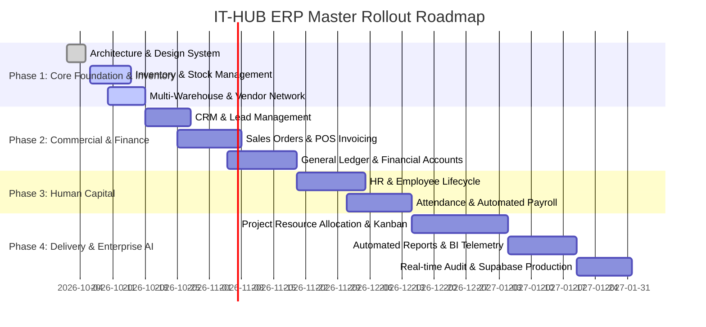

# 🏛️ IT-HUB ERP — Master Build Plan

## 1. Executive Summary & Vision
**IT-HUB ERP** is an enterprise-grade, multi-tenant Resource Planning and Operations management platform designed for modern engineering, logistics, manufacturing, and technology firms. It unifies operations across Inventory & Supply Chain, CRM, Sales & Invoicing, Finance & Accounting, HR & Attendance, Payroll, Project Resource Allocation, and Real-time Executive Telemetry.

---

## 2. Phased Rollout Roadmap

---

## 3. Module Breakdown & Deliverables

| Module | Primary Owner | Critical Capabilities | Status |
| :--- | :--- | :--- | :--- |
| **Inventory & Stock** | Supply Chain Lead | Barcode scanning, SKU generator, Stock In/Out movements, reorder radar, capacity tracking. | **Phase 1 Production** |
| **Multi-Depot Logistics** | Logistics Director | 4 global distribution facilities, bin allocation, capacity meters. | **Phase 1 Production** |
| **CRM & Accounts** | Sales Director | Lead pipeline, Customer directory, Deals tracker, Touchpoint activity logs. | **Phase 2 Scaffolded** |
| **Sales & Invoicing** | Commercial Lead | Sales orders, quotation generation, automated tax & discounts, fulfillment status. | **Phase 2 Scaffolded** |
| **Finance & Ledger** | Chief Financial Officer | Chart of accounts, double-entry ledger, P&L reporting, accounts payable/receivable. | **Phase 2 Scaffolded** |
| **HR & Directory** | HR Lead | Employee directory, departments, designations, documents, leave requests. | **Phase 3 Scaffolded** |
| **Payroll Engine** | Payroll Specialist | Salary breakdown (base, bonus, tax, deductions), payslip generator. | **Phase 3 Scaffolded** |
| **Projects & Tasks** | PMO | Milestone tracking, Kanban task boards, resource utilization. | **Phase 4 Scaffolded** |
| **Reports & BI** | Executive Suite | Exportable CSV/PDF reports, stock turnover velocity, gross margins. | **Continuous** |
| **Notifications** | Platform Architect | Real-time low-stock radar, order approvals, audit violation warnings. | **Phase 1 Production** |

---

## 4. Key Performance Indicators (KPIs)
1. **Zero Unplanned Stockouts**: Automated threshold alerts trigger replenishment purchase orders prior to safety stock depletion.
2. **Sub-100ms UI Latency**: High-performance client-side state caching with background asynchronous database reconciliation.
3. **100% Audit Traceability**: Every stock delta, invoice state transition, and user credential change is cryptographically logged with user identity and timestamp.
