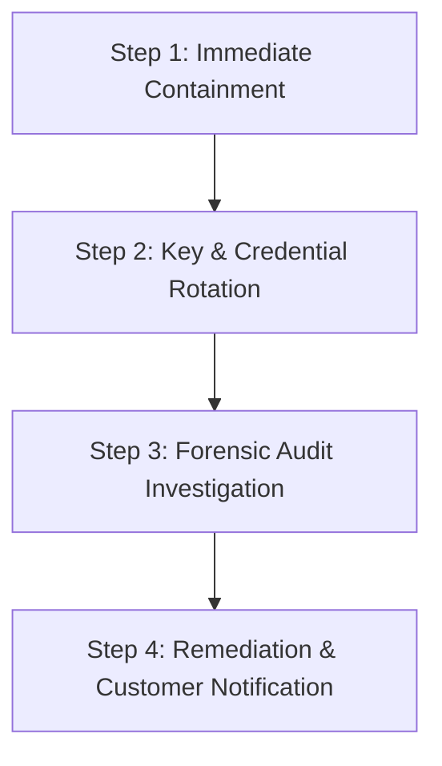

# ITHUB ERP — Security Architecture & Runbook

This document explains the security architecture, threat model, review procedures, and incident response plan for **ITHUB ERP**. It is written in plain English so that developers, operators, and business stakeholders can understand how the system is protected and how to respond if a security incident occurs.

---

## 1. What Is Protected

### 1. Multi-Tenant Isolation
* **Company-Scoped Database Queries**: Every operational database query is bound to the authenticated user's `companyId`. Queries run through tenant-scoped service wrappers.
* **Database Row Level Security (RLS)**: PostgreSQL tables have Row Level Security enabled. Even if an application query omits a filter, the database rejects rows belonging to other tenants.
* **Direct Object Reference (IDOR) Protection**: Detail pages and API routes (e.g. `/sales/invoices/[id]`, `/crm/customers/[id]`) verify that the requested record belongs to the active tenant before returning any data.

### 2. Portal Role Containment (Customers & Vendors)
* External customer users (assigned the `customer` role) are strictly bounded to their own customer account.
* Customer portal users cannot list internal staff members, view sales belonging to other clients, or access sensitive accounting records.

### 3. Role-Based Access Control (RBAC) & Privilege Integrity
* **Server-Side Enforcement**: All mutations and protected views require valid permissions verified via `requirePermission` on the server. UI-hidden buttons cannot be bypassed via direct HTTP calls.
* **Anti-Privilege Escalation**: Users cannot elevate their own roles or assign administrator privileges unless they are already an active administrator.
* **Last Administrator Guard**: The system prevents demoting or removing the sole active administrator of a tenant organization.

### 4. Authentication, Sessions & Password Policy
* **Password Complexity**: Minimum 10 characters requiring uppercase letters, lowercase letters, numbers, and special symbols.
* **Brute-Force & Credential Stuffing Defense**: Sliding-window rate limiting is enforced on login, registration, password resets, and search endpoints.
* **Constant-Time Verification**: Administrative credentials and tokens are evaluated using cryptographic constant-time comparison (`crypto.timingSafeEqual`) to eliminate timing-attack side channels.
* **Open Redirect Defense**: Post-login redirect targets are strictly validated to ensure they are relative paths on the same origin.

### 5. Data Masking & Separation of Duties
* **Sensitive Payroll & HR Masking**: Employee bank account numbers and national identification numbers are masked (e.g., `••••••••1234`) unless the viewer possesses the specific `employees:view_sensitive` permission.
* **Self-Approval Prevention**: Managers cannot approve their own leave requests or personal expense claims.

### 6. Export Safety & Output Sanitization
* **Formula Injection (CSV/Excel CWE-1236)**: Any field exported to CSV that starts with `=`, `+`, `-`, `@`, `\t`, or `\r` is automatically prefixed with a single quote (`'`), preventing malicious spreadsheet formulas from executing on opening.

### 7. HTTP & Browser Defense
* **Security Headers**: Production builds enforce strict HTTP response headers:
  * `Content-Security-Policy`: Disallows untrusted frames, object embeds, and rogue script injection.
  * `X-Frame-Options: DENY`: Blocks clickjacking attacks.
  * `X-Content-Type-Options: nosniff`: Prevents MIME-sniffing exploits.
  * `Referrer-Policy: strict-origin-when-cross-origin`.
  * `Permissions-Policy`: Restricts camera, microphone, and geolocation access.

---

## 2. Threat Model (Plain English)

| Threat | Description | How ITHUB ERP Prevents It |
|---|---|---|
| **Tenant Hopping** | A user from Company A changes an ID in the URL to view or tamper with Company B's invoices or payroll. | All queries enforce tenant isolation at both the service layer and database RLS. Mismatched IDs return 404 or access denied. |
| **Privilege Escalation** | A regular clerk modifies an API request or form payload to grant themselves Administrator rights. | Server actions verify caller role permissions independently from the client; users cannot alter their own role, and non-admins cannot grant admin roles. |
| **Credential Stuffing / Brute Force** | An attacker runs automated dictionaries of passwords against user and admin login forms. | Sliding-window IP and email rate limits temporarily lock out repeated failed attempts, and failed attempts trigger security anomaly alerts. |
| **Spreadsheet Formula Injection** | A user enters `=CMD\|' /C calc'!A0` as a customer name. An accountant downloads an invoice CSV and their spreadsheet executes code. | The CSV sanitizer detects formula-trigger characters (`=`, `+`, `-`, `@`) and neutralizes them with a leading quote. |
| **Open Redirect Phishing** | An attacker sends a link `https://erp.com/login?redirectTo=https://evil.com`. Once logged in, the user is redirected to a malicious clone. | `sanitizeRedirectPath` rejects absolute URLs, external domains, protocol-relative paths (`//evil.com`), and javascript URIs. |
| **Internal Data Snooping** | Employees browsing the system view colleagues' unmasked bank accounts or salary slips. | Sensitive banking information is masked by default and only decrypted/unmasked when explicit sensitive HR privileges are present. |

---

## 3. Human Reviewer Checklist

Before deploying any future feature or module to production, a reviewer must verify:

- [ ] **Tenant Isolation**: Does every new database table include `company_id`? Is RLS enabled with a tenant isolation policy?
- [ ] **Ownership Verification**: Does every route handler or server action that accepts an `id` check that the record belongs to the user's active company?
- [ ] **Permission Wrapper**: Is the mutation protected by `requirePermission(companyId, "permission:code")` at the top of the function?
- [ ] **Input Validation**: Are form inputs parsed and validated with Zod schemas? Are extra or unexpected fields stripped?
- [ ] **Data Export Safety**: Are all tabular exports passed through `sanitizeCSVCell` / `sanitizeCSVRow` before writing to CSV?
- [ ] **Customer Portal Isolation**: If the route is accessible by customer or vendor roles, is the query restricted strictly to their own entity ID?
- [ ] **No Hardcoded Secrets**: Are API keys, passwords, and tokens retrieved exclusively from server-side environment variables?
- [ ] **Audit Trail**: Are high-risk actions (role changes, user deactivations, financial posts) recorded via `recordAuditLog`?

---

## 4. Incident Response Plan

If an alert triggers, credentials leak, or an account is suspected of compromise, execute the following steps in sequence:

### Step 1: Immediate Containment (Revoke Sessions)
1. **Disable the Compromised User**:
   * Navigate to `/admin/users` or execute administrative deactivation to immediately set the user's status to `inactive`.
   * The middleware and auth guards reject inactive user requests on their very next request.
2. **Revoke Active Supabase Sessions**:
   * If an entire account was hijacked, revoke the user's session in the Supabase Dashboard: **Authentication > Users > Revoke Session**.
3. **Emergency IP Block**:
   * If attacks originate from specific CIDR ranges, block the IP addresses at the Vercel / Cloudflare edge firewall.

### Step 2: Key & Credential Rotation
If an environment secret or database credential is leaked:
1. **Rotate Supabase Service Role Key**:
   * In Supabase Dashboard: **Project Settings > API > Reset Service Role Key**.
   * Update `SUPABASE_SERVICE_ROLE_KEY` in Vercel project environment variables.
2. **Rotate Admin Secret**:
   * Generate a new 32+ character random secret: `openssl rand -hex 32`.
   * Update `ADMIN_SESSION_SECRET` and `ADMIN_PASSWORD` in Vercel.
3. **Trigger Immediate Redeployment**:
   * Deploy the project immediately to purge old build artifacts and flush existing session caches.

### Step 3: Forensic Audit Investigation
1. Navigate to `/admin/audit-logs`.
2. Filter logs by the compromised user's ID and IP address during the incident window.
3. Determine:
   * What records were viewed or exported.
   * Whether any permissions, roles, or financial data were modified.
   * If any other accounts were accessed from the same IP.
4. Export the immutable audit trail for documentation and compliance records.

### Step 4: Remediation & Client Notification
1. Fix any exploited vulnerability and deploy automated regression tests.
2. If personal, financial, or confidential data was accessed by an unauthorized party, notify the affected tenant administrators within the statutory reporting window (e.g. 72 hours under GDPR/NDB regulations).
3. Provide affected clients with an executive summary of the incident, what data was exposed, and the remediation steps taken.

---

## 5. Known Remaining Operational Items

1. **Supabase Cloud Dashboard Settings** (Must be configured in your Supabase project):
   * Enable **Confirm Email** under *Authentication > Providers > Email*.
   * Enable **Multi-Factor Authentication (MFA)** under *Authentication > MFA* (App Authenticator / TOTP).
   * Ensure storage buckets (`company-assets`, `receipts`) are marked **Private** with appropriate storage RLS policies.
2. **Production Secrets in Vercel**:
   * Ensure `ADMIN_PASSWORD` and `ADMIN_SESSION_SECRET` are set to strong, unique strings in your production environment settings (never use default values in production).
3. **Dependency Upgrades**:
   * Development dependencies `chokidar@3` and `postcss-nested` (bundled with Tailwind CSS v3) have upstream advisories. When migrating to Tailwind CSS v4 in a future scheduled release, these will be cleanly resolved.
